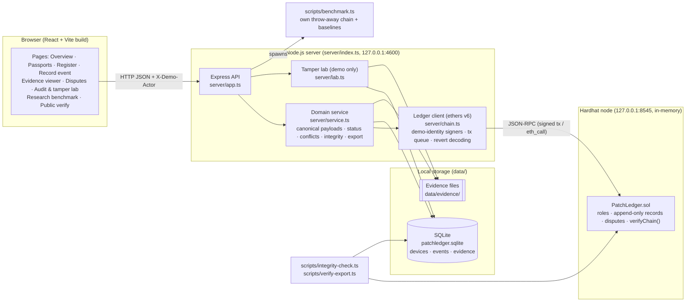
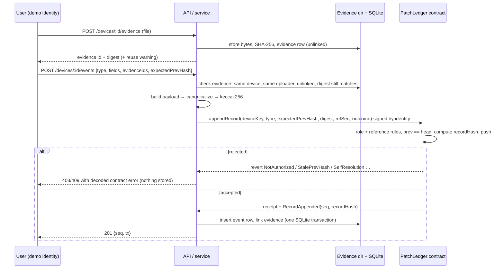

# Architecture

PatchLedger runs entirely on `127.0.0.1`. It has three parts: a local Hardhat chain with the `PatchLedger` Solidity contract, one Node.js process serving both the Express API and the built React app, and local storage (SQLite plus an evidence directory).

## Component diagram



## What is stored where

| Data | Where | Why |
|------|-------|-----|
| Opaque device key `keccak256("patchledger:device:" + publicId)` | chain | Shared identifier that contains no serial number |
| Record hash, previous hash, payload digest, actor address, block timestamp, sequence, type, reference, outcome | chain (one `Record` struct, 4 storage slots) | Integrity, provenance and ordering that the contract enforces |
| Open-dispute and supersession state | chain (mappings) | So nobody can hide disputes or corrections off-chain |
| Full canonical payload (description, component, result, measurements, evidence list, nonce) | SQLite `events.payload` | Detail and privacy; committed by the on-chain digest |
| Device brand, model, year | SQLite `devices`, and inside the committed registration payload | Display; edits are detectable |
| Evidence bytes | `data/evidence/<id>.<ext>` | Never on-chain |
| Evidence SHA-256, uploader, access level | SQLite `evidence`; the digest is also inside the committed payload | Re-verification and access control |

## Hashing and canonical serialization

- **Canonical payload** ([`server/canonical.ts`](../server/canonical.ts)): keys sorted, no whitespace, strings NFC-normalized, integers only (floats are rejected), keys with value `undefined` omitted. Every payload carries a random 128-bit `nonce`, so short or predictable payloads cannot be guessed from their on-chain digest.
- **Payload digest** = `keccak256(utf8(canonical))`.
- **Record hash**, computed by the contract and re-implemented in [`server/ledger-hash.ts`](../server/ledger-hash.ts):
  `keccak256(abi.encode(keccak256("PatchLedger.Record.v1"), chainId, contract, deviceKey, seq, type, prevHash, payloadDigest, actor, timestamp, refSeq, outcome))`
- **Evidence digest** = SHA-256 of the raw file bytes (hex). It is committed indirectly because it sits inside the payload.

## Data flow: recording a repair with evidence



The chain write happens **before** the database write. If the server crashed between the two, the integrity checker would report `OFFCHAIN_RECORD_MISSING`; nothing would pass silently.

## Integrity checker

`PatchLedgerService.checkIntegrity`, exposed by the UI, `GET /api/devices/:id/integrity` and `npm run integrity`, checks:

1. On-chain records recompute locally and link correctly; the contract's `verifyChain()` agrees.
2. Every on-chain record has an off-chain row (`OFFCHAIN_RECORD_MISSING`), and every off-chain row has an on-chain record (`UNANCHORED_RECORD`).
3. Each stored payload is canonical and its digest equals the on-chain `payloadDigest` (`PAYLOAD_DIGEST_MISMATCH`). Record hash, actor, type, reference and outcome agree.
4. Each evidence file re-hashes to the SHA-256 committed in its payload (`EVIDENCE_FILE_ALTERED` or `_MISSING`), and the database digest was not edited (`EVIDENCE_DIGEST_EDITED`).
5. Device metadata matches the committed registration payload (`DEVICE_METADATA_EDITED`).
6. Reused evidence digests produce warnings (`EVIDENCE_DIGEST_REUSED`).

`scripts/verify-export.ts` repeats steps 1, 3 and 4 from an exported JSON file. It can optionally check the live chain (`--rpc`) and the evidence files (`--evidence-dir`), and it does not need the PatchLedger server.

## Evidence-status derivation

The status is computed per claim, in order of precedence:

1. **Disputed:** an unresolved challenge exists.
2. **Corrected / superseded:** a correction references the claim.
3. **Evidence integrity failed:** an attached file no longer matches its committed digest.
4. **Independently corroborated:** a corroboration record exists, from an actor *different* from the claim's author, with at least one evidence file whose digest matches.
5. **Evidence attached:** at least one evidence file exists and all match.
6. **Self-reported:** no evidence.

Further flags: a claim rejected by an auditor, reused digests, corroboration without evidence, conflicting component claims, and off-chain/on-chain mismatch.

## Repository layout

```
contracts/PatchLedger.sol      Solidity contract
hardhat.config.cjs             compile + local node config (no public networks)
server/                        API, service, ledger client, store, evidence, tamper lab
web/                           React + Vite frontend (design system in web/src/styles.css)
scripts/                       deploy, seed, benchmark, integrity-check, verify-export, lib/
tests/contract/                contract tests (real local chain)
tests/app/                     API/service tests (real chain + Express)
tests/smoke/                   ./run.sh startup and shutdown test
docs/                          research documents and generated results
run.sh                         one-command startup
```
