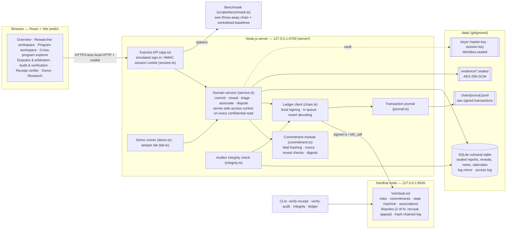

# Architecture

VulnSeal runs entirely on `127.0.0.1`. It has three parts:

- a local Hardhat chain with the `VulnSeal` contract;
- one Node.js process serving both the Express API and the built React app;
- a local data directory: SQLite, an encrypted vault for reports and evidence, a key store, and the transaction journal.

## Components



## Data placement

| Data | Where | Who can read it |
|------|-------|-----------------|
| Commitment hash, researcher address, program id, policy version, block time, status, mismatch count, reveal digest, issue-family token | Contract state, plus events | Every participant of the network |
| Hash-chained log (kind, subject, actor, time, data hash) | Contract (`logEntries`, `logHead`), plus `LogAppended` events | Every participant |
| Program name tags and policy digests | Contract | Every participant (policy text is off-chain) |
| Report text, nonce, private notes | `reports.sealed` (vault, AAD `report:<id>`) | The researcher (and the operator holding the vault key) |
| Revealed copy of a report | `reveals.sealed` | The receiving program; programs granted on-chain disclosure; unconflicted arbitrators of an active dispute |
| Evidence bytes and file names | `evidence/*.sealed`, `evidence.sealed_name` | Same as the report. The SHA-256 is part of the commitment |
| Rationales, statements, triage notes | `associations` / `disputes` / `dispute_acts` / `notes` (sealed); salted digest on-chain | Parties to the dispute, eligible arbitrators, staff of the involved programs |
| Payout identity of researchers | `identity_private` (sealed) | The researcher only |
| Content access log | `access_log` | The auditor |

## Lifecycle state machine

```mermaid
stateDiagram-v2
  direction LR
  [*] --> Anchored: anchorCommitment (researcher)
  Anchored --> Acknowledged: acknowledge (program staff)
  Acknowledged --> RevealRequested: requestReveal (program staff)
  RevealRequested --> RevealRequested: recordReveal MISMATCH / MISSING / BAD_ENCODING (mismatches += 1)
  RevealRequested --> Revealed: recordReveal MATCH (reviewer, not the researcher)
  Revealed --> PendingTriage: setTriage
  PendingTriage --> NeedsInfo: setTriage
  PendingTriage --> Valid: setTriage
  PendingTriage --> Invalid: setTriage
  NeedsInfo --> PendingTriage: setTriage
  NeedsInfo --> Valid: setTriage
  NeedsInfo --> Invalid: setTriage
  Valid --> Invalid: validity dispute decided "invalid"
  Invalid --> Valid: validity dispute decided "valid"
  Valid --> Finalized: finalizeReport (admin, no open dispute)
  Invalid --> Finalized: finalizeReport (admin, no open dispute)
  Anchored --> Superseded: reviseCommitment (owner) → new commitment
  Acknowledged --> Superseded
  RevealRequested --> Superseded
  Finalized --> [*]

  state Dispute {
    direction LR
    [*] --> Open: openDispute (party)
    Open --> Decided: 2 matching votes (unconflicted arbitrators)
    Decided --> Appealed: appeal (party, within window)
    Appealed --> Final: 2 matching votes (fresh panel)
    Decided --> Final: closeDispute (after window)
  }
```



`Superseded` is not a status field. It is the `supersededBy` reference: the original keeps its status and stays on record, and the contract refuses further actions on it. Associations follow `Proposed → Confirmed | Rejected` (review by the *other* program), then `→ Disputed → Upheld | Overturned` (arbitration). A same-issue relation that is confirmed or upheld assigns an issue-family token.

## Write path: commit, then reveal

1. The researcher submits the report form. The server hashes each field, combines the result with the evidence SHA-256 root, draws a 256-bit nonce, and computes the commitment.
2. The ledger client signs `anchorCommitment` with the researcher's key, broadcasts it, waits for the receipt and appends the raw transaction to the journal.
3. The report and nonce are sealed in the vault, the off-chain row is written, and the `LogAppended` event is mirrored.
4. The program's staff acknowledge and request a reveal, each as its own transaction.
5. The researcher reveals: the server builds the package from the vault, an uploaded recovery package or an edited copy, and runs a pre-check. The package is stored sealed and becomes readable by the program's staff.
6. The reviewer verifies: a local check plus `verifyOpening` by `eth_call`, then `recordReveal(outcome, revealDigest)` as a transaction.

## Persistence across restarts

A Hardhat node keeps its state in memory. VulnSeal makes the ledger survive restarts by **journaling every raw signed transaction**, together with its block number and timestamp, and **replaying** the journal into a fresh node:

- The node starts with its clock at 2020-01-01, so original block times can be re-applied with `evm_setNextBlockTimestamp`.
- After the replay, an empty block moves the clock to the present.
- The replay checks every transaction hash and block number. The tests check that **every block hash is identical** after a restart.
- `bootstrap.ts` then compares the on-chain log head with the off-chain mirror.

`./run.sh --reset` archives the data directory and starts a new ledger.

## Access control (server-side)

Every confidential read goes through `contentAccess(viewer, cid)` in the service:

- **Owner:** the sealed original.
- **Staff of the receiving program:** the revealed copy, only after a reveal exists.
- **Staff of another program:** the revealed copy, only if the contract has `disclosedTo[cid][program]`.
- **Arbitrator:** the revealed copy, only while an active dispute involving the report is open and the arbitrator is not affiliated with an involved program.
- **Auditor:** never content.

Denied and allowed reads are logged. Report ids are sequential, so ID-guessing attacks are explicitly tested.

**Demo identity selection is simulated.** Choosing an identity issues an HMAC-signed cookie with no password. The contract still checks the signer of every transaction.

## Repository layout

```
contracts/VulnSeal.sol           contract
server/                          API, service, commitment, receipt, integrity, vault, journal, keys, sessions, demo, lab
web/                             React + Vite frontend (design system in web/src/styles.css, icons from lucide-react)
scripts/bootstrap.ts             initialise or restore the ledger (used by run.sh)
scripts/seed.ts                  fictional programs, researchers, reports, associations, disputes
scripts/benchmark.ts             comparative benchmark; scripts/lib/baselines.ts holds the centralised designs
scripts/verify-receipt.ts, verify-audit.ts, integrity-check.ts, show-chain.ts   independent CLIs
tests/contract, tests/app, tests/smoke                                            automated tests
docs/                            research documents, results, PatchLedger archive
```
